# The Seven Towers
Last updated: 2026-10-20

The Seven Towers is a residential high-rise project by Family Builders & Developers in Karachi, Pakistan. Seven interconnected towers rise 35 floors (about 378 ft) on a plot of approximately 15,650–15,670 square yards, with 1,392 apartments of 2, 3, 4 and 5 bedrooms. The project is approved by SBCA (Sindh Building Control Authority). Construction is underway and completion is targeted for around 2032.

## Launch status (critical for sales)
- **Launched and selling now:** Alpha, Harmony, Imperial, Nexus.
- **Launching soon (not open for booking yet):** Cove, Elite, Oasis. If asked about these three, say they will be launched soon and invite the prospect to register interest with the sales team. Do not invent prices, sizes or payment plans for them.
- **Alpha Tower is completely sold out.** Still share Alpha unit info, floor plans and payment plans for reference and comparison, but clearly state that Alpha is sold out and guide the prospect to available towers (Harmony, Imperial, Nexus).

## Project at a glance
<!-- table: project-at-a-glance -->
| Detail | Value |
|---|---|
| Developer | Family Builders & Developers (established 2003) |
| City | Karachi, Pakistan |
| Towers | 7: Alpha, Imperial, Harmony, Nexus, Cove, Elite, Oasis |
| Floors | 35 |
| Height | About 378 ft |
| Apartments | 1,392 (2, 3, 4 and 5 bedrooms) |
| Plot size | Approximately 15,650–15,670 square yards |
| Approval | SBCA (Sindh Building Control Authority) |
| Construction start | First dig around July 2025 |
| Targeted completion | Around 2032 |

## Status and timeline
- Construction began with the first dig around July 2025, and the early floors are progressing in 2026.
- Completion is targeted for around 2032.
- Construction progress is publicly updated, and site visits are encouraged.

## Location and connectivity
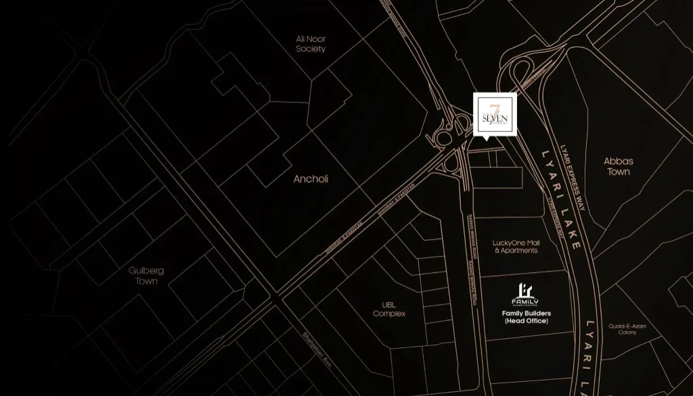

- **Address:** Plot LA-4 / LA-4/1, Shahrah-e-Pakistan (also referred to as Rashid Minhas Road), Federal B Area Block 21, Gulberg Town, Karachi 75950.
- At the junction of **Rashid Minhas Road** and **Shahrah-e-Pakistan**, near LuckyOne Mall & Apartments and the Lyari Expressway.
- A gated community with strong urban connectivity for shopping, healthcare, education and commuting.
- **Malls and roads:** LuckyOne Mall is minutes away. Major roads link to Gulshan-e-Iqbal, North Nazimabad, the city center, M9 and the Lyari Expressway.
- **Hospitals nearby:** Noor, Mamji, Patel, Al Shafa, JDC.
- **Banks and ATMs nearby:** Dubai Islamic, Bank Al Habib, Faysal, Habib Metro, Soneri, Meezan.
- **Supermarkets nearby:** Imtiaz, Carrefour, The Big Buy.
- **Petrol stations nearby:** Shell, PSO, Total Parco.
- **Sports and parks nearby:** UBL Sports Complex, Mansora Playground, Allama Iqbal Park.
- Banquet halls, cafes, restaurants and other daily amenities are also close by.

## Building layout and infrastructure

### Levels
<!-- table: building-levels -->
| Level | Use |
|---|---|
| Two basements | Parking |
| Ground floor | Lobby and amenities |
| Floors 1–5 | Parking |
| Floors 6–19 | Apartments |
| Floor 20 | "Connect": shared amenity level with sky bridges linking the towers |
| Floors 21–35 | Apartments |

### Infrastructure and services
- 21 passenger lifts (high-speed) and 7 cargo lifts.
- 7 emergency exits and staircases.
- 21 garbage chutes with a collection system.
- 7 sets of firefighting equipment and a fire detection and alarm system.
- Power from the city grid, solar and backup generators.
- EV charging stations, provided as required.
- Separate entrance and exit ramps; residential and visitor parking, provided as required.
- Keyless entry, 24/7 CCTV and security, professional management, housekeeping and garbage control.

### Construction standards
- Steel-reinforced concrete framework with premium cement and aggregates.
- UV-protective exterior paint, privacy glass and PVC window frames.
- MS steel staircase railings and window grills; marble-top staircases.
- Plywood doors and frames (galvanized steel, termite-free).
- Durable PPR pipes for hot and cold water and PVC drainage.
- Separate conduits for power, data and control wiring; pre-installed fiber optic cabling.
- Gas meter regulator room, multiple underground and overhead water tanks, and a reverse osmosis plant.
- Brass fixtures, ceramic sanitary ware and porcelain tiles.

## The seven towers
Each tower has its own identity and apartment focus. All towers share the 20th-floor "Connect" level (community, relaxation and wellness hub linked by sky bridges) and the ground-level facilities.

<!-- table: towers-overview -->
| Tower | Status | Theme | Apartment focus | Dedicated amenities |
|---|---|---|---|---|
| Alpha | Completely sold out (info still shared) | Sanctuary of Evolutionaries / Learning | 2-bed, 3-bed, 4-bed | Learning Center: Library, Media Room, Islamic Room |
| Imperial | Launched | Arena for Champions | 2-bed, 3-bed, 4-bed | Gaming Center, Indoor Games and Arcade |
| Harmony | Launched | Haven for the Blooming | 3-bed only | Day Care, Children's Play Area, Study Room |
| Nexus | Launched | Social Pulse / Social Gathering | 3-bed and 6-bed | Club House and Social Gathering |
| Cove | Launching soon | Echoes of Calm | To be announced at launch | Cafeteria and Lounge: Coffee Café, Juice Bar |
| Elite | Launching soon | Forge of the Powerful / Fitness | To be announced at launch | Fitness Center: Gym and Yoga |
| Oasis | Launching soon | Waterborne Escape / Relaxation | To be announced at launch | Spa Pool and Sauna |

## Launched towers — unit types, floor plans and payment plans
All amounts are in PKR. Quote figures exactly as listed. Category charge: +5% for road-facing, park-facing, corner-facing or fountain-facing units, where applicable (confirm with sales). The developer states there are no hidden charges. Availability, facing options and final offers must be confirmed with the sales team.

### Alpha Tower (completely sold out)
Share the details below for reference, but always state that Alpha is completely sold out and suggest Harmony, Imperial or Nexus.

#### Alpha Type A — 4-bedroom lounge apartment, 2,189.67 sq ft
A thoughtfully designed 4-bedroom Alpha Tower floor plan where open living spaces flow seamlessly into private, elegant retreats.
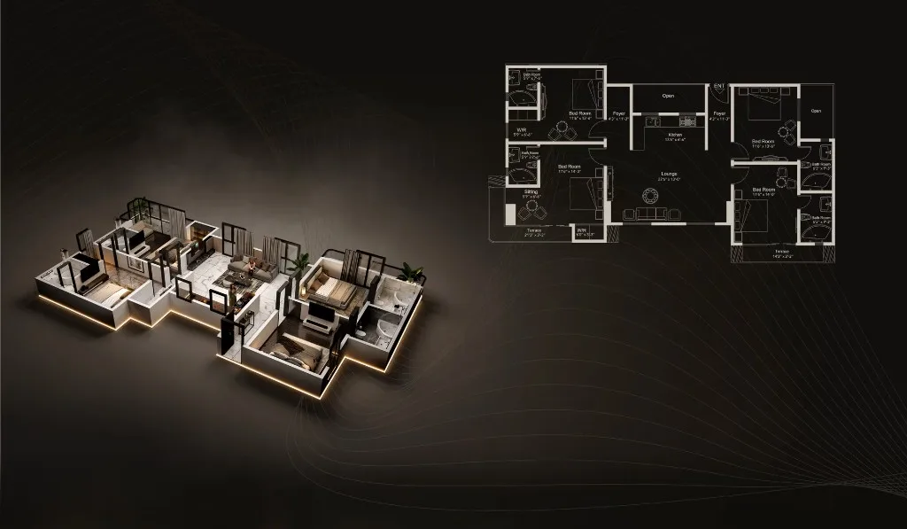

<!-- table: alpha-type-a-payment -->
| Installment | Payable (PKR) |
|---|---:|
| Down payment | 5,425,000 |
| 54 monthly installments | 361,574 each |
| 4 yearly installments | 1,775,000 each |
| On completion | 3,550,000 |
| Total | 35,500,000 |

#### Alpha Type B — 2-bedroom lounge apartment, 1,158.36 sq ft
Premium living in a perfectly proportioned space that prioritizes comfort, flow and understated luxury.
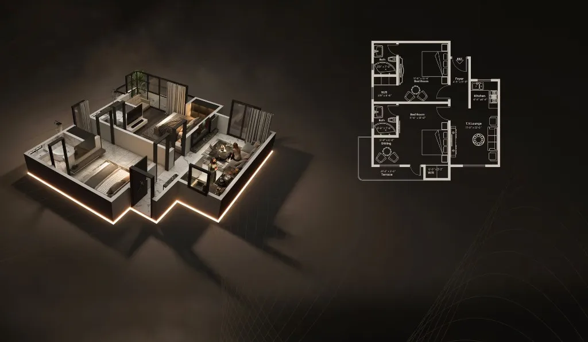

<!-- table: alpha-type-b-payment -->
| Installment | Payable (PKR) |
|---|---:|
| Down payment | 2,775,000 |
| 54 monthly installments | 188,426 each |
| 4 yearly installments | 925,000 each |
| On completion | 1,850,000 |
| Total | 18,500,000 |

#### Alpha Type C — 3-bedroom lounge apartment, 1,031.31 sq ft
A complete luxury lifestyle within a brilliantly compact footprint, ideal for modern, comfortable living.
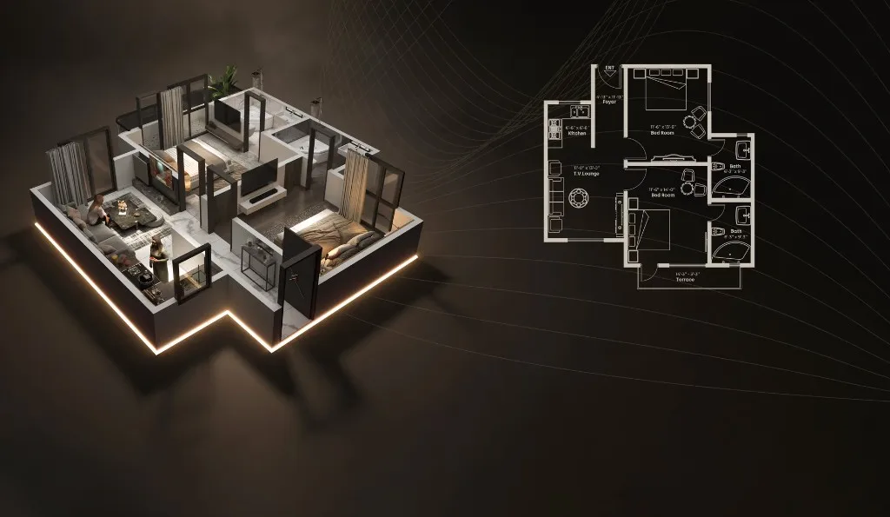

<!-- table: alpha-type-c-payment -->
| Installment | Payable (PKR) |
|---|---:|
| Down payment | 2,550,000 |
| 54 monthly installments | 173,148 each |
| 4 yearly installments | 850,000 each |
| On completion | 1,700,000 |
| Total | 17,000,000 |

### Imperial Tower (launched)
#### Imperial Type A — 4-bedroom lounge apartment, 2,350 sq ft
Spacious 4-bedroom lounge apartment with an expansive layout, ideal for large families, offering comfort, privacy, modern design and premium lifestyle features.
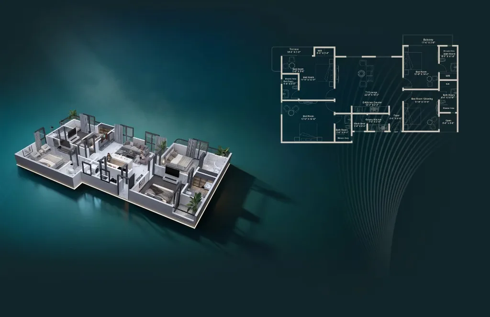

<!-- table: imperial-type-a-payment -->
| Installment | Payable (PKR) |
|---|---:|
| Down payment | 5,175,000 |
| 60 monthly installments | 316,250 each |
| 9 half-yearly installments | 766,666 each |
| On completion | 3,450,000 |
| Total | 34,500,000 |

#### Imperial Type B — 2-bedroom lounge apartment, 1,158.36 sq ft
Well-designed 2-bedroom lounge flats featuring a smart layout, ample space and natural light, perfect for families seeking comfort and practical modern living.
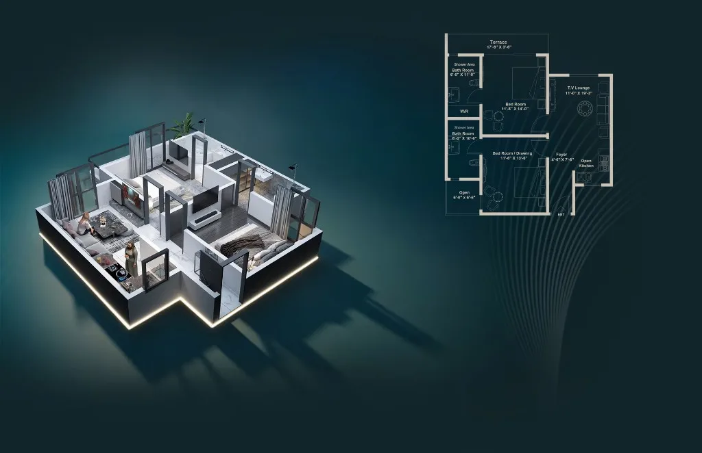

<!-- table: imperial-type-b-payment -->
| Installment | Payable (PKR) |
|---|---:|
| Down payment | 2,700,000 |
| 60 monthly installments | 165,000 each |
| 9 half-yearly installments | 400,000 each |
| On completion | 1,800,000 |
| Total | 18,000,000 |

#### Imperial Type C — 3-bedroom lounge apartment, 1,031.31 sq ft
Compact yet efficient 3-bedroom lounge apartment designed for comfortable living, with functional spaces, a modern layout and an ideal urban lifestyle choice.
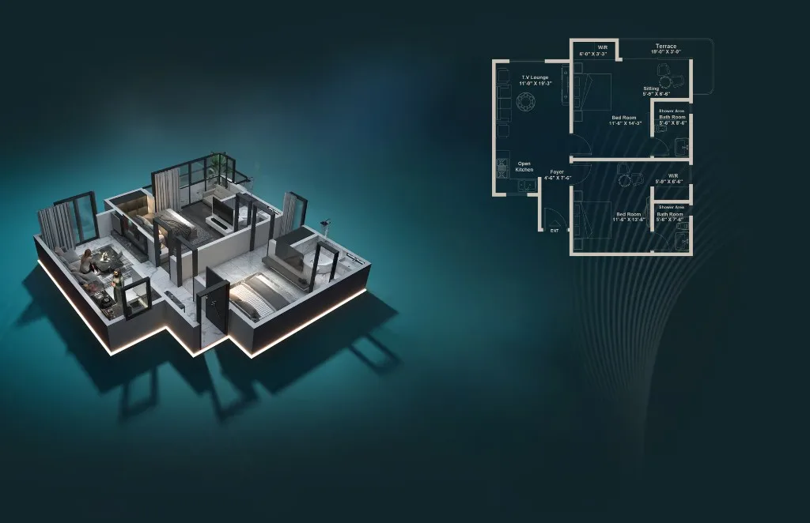

<!-- table: imperial-type-c-payment -->
| Installment | Payable (PKR) |
|---|---:|
| Down payment | 2,370,000 |
| 60 monthly installments | 145,000 each |
| 9 half-yearly installments | 350,000 each |
| On completion | 1,580,000 |
| Total | 15,800,000 |

### Harmony Tower (launched)
#### Harmony Type A — 3-bedroom lounge apartment, 1,684.68 sq ft
Spacious 3-bedroom lounge apartment with an expansive layout, modern finishes, ample natural light and comfortable living spaces ideal for growing families.
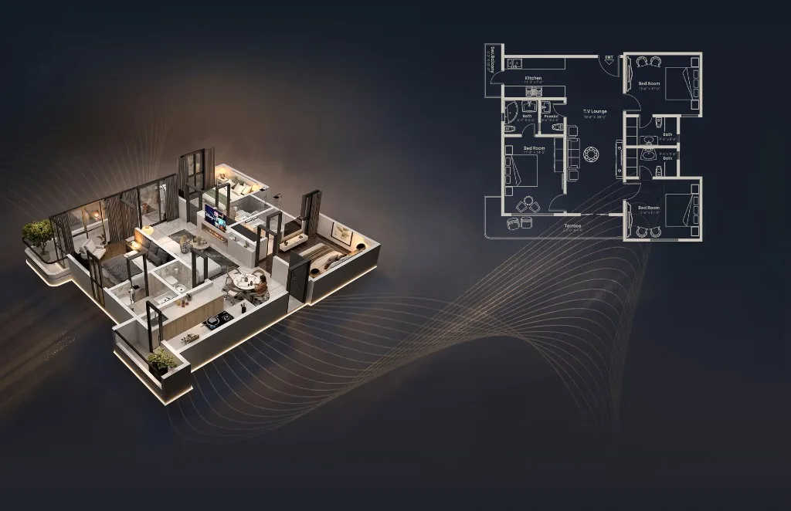

<!-- table: harmony-type-a-payment -->
| Installment | Payable (PKR) |
|---|---:|
| Down payment | 4,200,000 |
| 60 monthly installments | 256,666 each |
| 9 half-yearly installments | 622,222 each |
| On completion | 2,800,000 |
| Total | 28,000,000 |

#### Harmony Type B — 3-bedroom lounge apartment, 1,545.06 sq ft
Well-designed 3-bedroom lounge apartment offering balanced space, a functional layout, stylish interiors and a comfortable environment for modern family living.
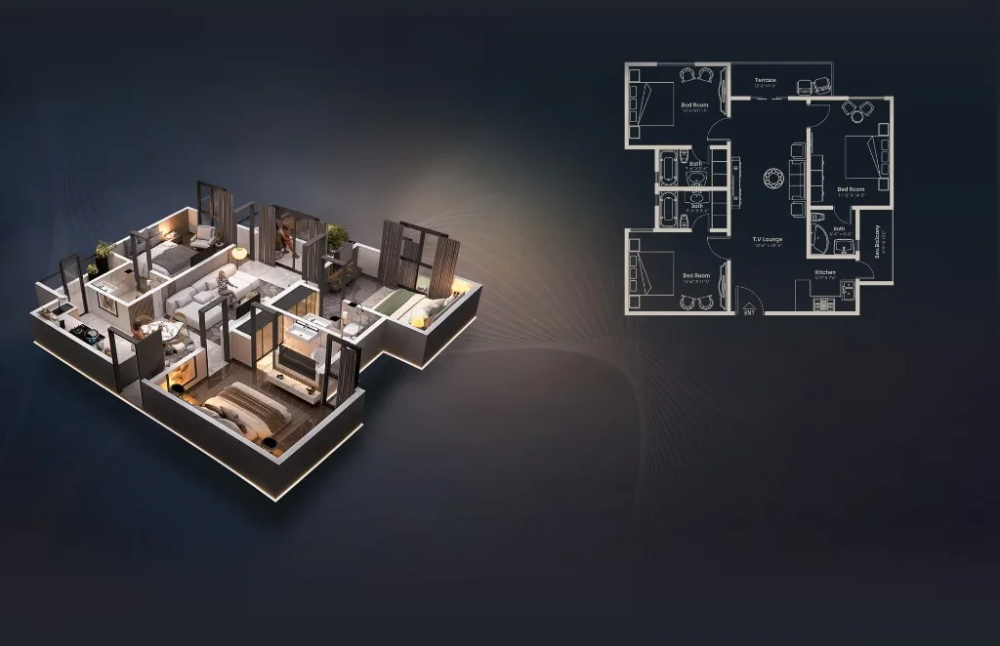

<!-- table: harmony-type-b-payment -->
| Installment | Payable (PKR) |
|---|---:|
| Down payment | 3,450,000 |
| 60 monthly installments | 210,833 each |
| 9 half-yearly installments | 511,111 each |
| On completion | 2,300,000 |
| Total | 23,000,000 |

#### Harmony Type C — 3-bedroom lounge apartment, 1,465.38 sq ft
Compact yet efficient 3-bedroom lounge apartment featuring a smart layout, modern design, optimized space and comfortable living for urban families.
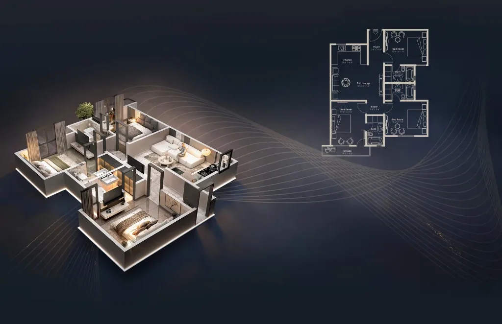

<!-- table: harmony-type-c-payment -->
| Installment | Payable (PKR) |
|---|---:|
| Down payment | 3,225,000 |
| 60 monthly installments | 197,250 each |
| 9 half-yearly installments | 477,777 each |
| On completion | 2,150,000 |
| Total | 21,500,000 |

### Nexus Tower (launched)
Nexus Type A and Type B use the same payment structure as Imperial and Harmony: about 15% down payment, 55% across 60 monthly installments, 20% across 9 half-yearly installments, and 10% on completion.

#### Nexus Type A — 3-bedroom apartment, 1,715 sq ft

<!-- table: nexus-type-a-payment -->
| Installment | Payable (PKR) |
|---|---:|
| Down payment | 4,650,000 |
| 60 monthly installments | 284,167 each |
| 9 half-yearly installments | 688,889 each |
| On completion | 3,100,000 |
| Total | 31,000,000 |

#### Nexus Type B — 3-bedroom apartment, 1,575 sq ft

<!-- table: nexus-type-b-payment -->
| Installment | Payable (PKR) |
|---|---:|
| Down payment | 4,275,000 |
| 60 monthly installments | 261,250 each |
| 9 half-yearly installments | 633,333 each |
| On completion | 2,850,000 |
| Total | 28,500,000 |

#### Nexus Type C — 6-bedroom apartment
Price and payment plan are not publicly listed. Direct the sales person (or prospect) to contact the sales team for details.

## Quick comparison of launched units
<!-- table: unit-sizes -->
| Tower | Type | Bedrooms | Area (sq ft) | Total (PKR) | Availability note |
|---|---|---|---:|---:|---|
| Alpha | A | 4 | 2,189.67 | 35,500,000 | Sold out |
| Alpha | B | 2 | 1,158.36 | 18,500,000 | Sold out |
| Alpha | C | 3 | 1,031.31 | 17,000,000 | Sold out |
| Imperial | A | 4 | 2,350 | 34,500,000 | Launched |
| Imperial | B | 2 | 1,158.36 | 18,000,000 | Launched |
| Imperial | C | 3 | 1,031.31 | 15,800,000 | Launched |
| Harmony | A | 3 | 1,684.68 | 28,000,000 | Launched |
| Harmony | B | 3 | 1,545.06 | 23,000,000 | Launched |
| Harmony | C | 3 | 1,465.38 | 21,500,000 | Launched |
| Nexus | A | 3 | 1,715 | 31,000,000 | Launched |
| Nexus | B | 3 | 1,575 | 28,500,000 | Launched |
| Nexus | C | 6 | — | Contact sales | Launched; price on request |

## Amenities
More than 40 amenities and features, shared across the project:

- **Wellness and sports:** rooftop swimming pool and BBQ area, fitness center (gym and yoga), spa and sauna (spa pool), jogging deck and outdoor relaxation zones, cricket ground and football court (courtyards).
- **Family and learning:** learning center (library, media room, Islamic room), day care, children's play area, study room.
- **Social and leisure:** indoor games, arcade and gaming zone, club house and community hall, social gathering spaces.
- **Dining:** cafeteria and restaurants, coffee café, juice bar.
- **Shopping and services:** reception lobby, mini mart (general store, dry cleaners, salon, dairy, meat, hardware, fruit and vegetables, tandoor), banking zone, prayer area and mosque.
- **Building services:** housekeeping and garbage control, high-speed lifts, EV charging, 24/7 security and CCTV, fountain features, green spaces.

Tower-specific amenities add to this: family-oriented in Harmony, fitness in Elite (launching soon), gaming in Imperial, wellness in Oasis (launching soon).

## About the developer
Family Builders & Developers (CEO Abdullah Tariq) has delivered more than 15 residential and commercial projects across Karachi since about 2003–2004, including in PECHS, Bahria Town and the M.A. Jinnah Road area. Projects include Family Heaven & Sana Residency (13 floors, mixed use), Abdullah Castle (6 floors), Family Comfort (4 floors, residential), Bab-e-Usman, Avenue 50 and 54, 15 Jinnah, Townhouses, 252 Noor Medical, SQFMR (30 floors), SQ Family Bazaar (Bahria Town) and Arif Plaza. The company emphasizes quality construction, transparent dealings, on-time delivery, completion certificates and ongoing management. The Seven Towers is its flagship high-rise project.

## Why choose The Seven Towers
- A lifestyle-focused gated community, not just housing: open layouts, views, uninterrupted power backup and professional management.
- Strong location near major retail, healthcare and transport.
- Flexible installment plans with a clear booking structure.
- SBCA approval, safety systems, solar power and strong connectivity.
- Construction progress is publicly updated, and site visits are encouraged.

## Contact
- **Office:** Plot No. LA-4/1, Shahrah-e-Pakistan, Federal B Area Block 21, Karachi.
- **Phone:** +92 321 2266661
- **Websites:** thefamilybuilders.com and seventowers.thefamilybuilders.com
- **Social media:** @thefamilybuildersPK (Facebook, Instagram, LinkedIn and others)
- Register interest or download brochures on the official site. Confirm current pricing, availability, facing options and arrange a site visit through the sales team.

## Not covered here
Refer these questions to the sales team / management:
- Prices and plans for Cove, Elite and Oasis (launching soon — no public figures yet).
- Nexus Type C price and payment breakdown.
- Current unit availability by floor/number, and facing options per unit.
- Booking steps and required documents.
- Possession and handover terms beyond the targeted completion year.
- Maintenance charges, utility connection charges and taxes.
- Cancellation, transfer and refund policy.
- Discounts, category-charge calculations and any non-listed offer.
